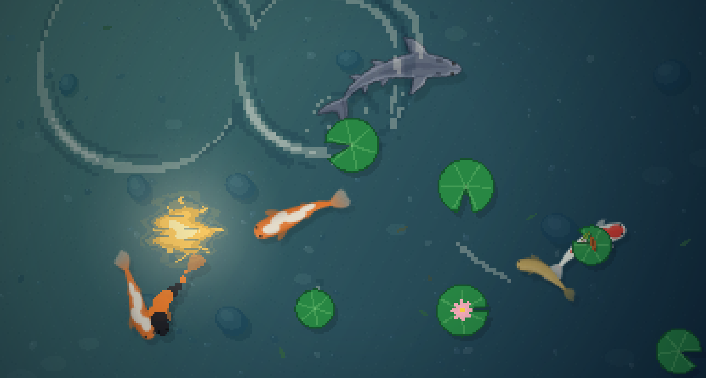

 
## Custom fish
 
Drop your own fish into the `fish/` folder next to `extension.js`:
 
```
fish/
  koi/
    koi1.png        top-down picture, head pointing right
    koi3.json       skeleton parameters only, drawn by code
  ca-chep/
    cachep1.png
    cachep1.json    optional settings for the picture with the same name
```
 
Each folder is a species and each file is one kind of fish.
 
### Turning it on
 
Go to **Preferences → Koi**, switch on **Use custom fish**, then set how many of each file should swim (0 skips it, new files start at 1). Press **Rescan** after adding files. Switching it off, or leaving `fish/` empty, brings back the built-in koi.
 
### Pictures (`.png`)
 
The picture is sliced into strips and bent along the fish's skeleton, so it swims, casts a shadow and avoids other fish like the built-in ones. Use a transparent background and draw the fish straight, with fins and tail spread out.
 
All fields below go in an optional `.json` with the same name as the picture.
 
| Field | Default | Meaning |
|---|---|---|
| `facing` | `"right"` | Where the head points: `right`, `left`, `up`, `down` |
| `flip` | `false` | Mirror the picture |
| `length` | `6.4` | Picture length in fish sizes (max 60) |
| `headOffset` | `0.5` | How far the snout sticks out past the first joint |
| `size` | `[15, 24]` | Random size range |
| `speed` | `[38, 62]` | Random speed range |
| `strips` | `16` | Number of strips (more = smoother, heavier) |
| `tailSwing` | `0.35` | Tail wag |
| `segments` | `9` | Joints in the skeleton (4 to 40) |
| `spacing` | `0.55` | Distance between joints |
| `bend` | `0.3` | Max turn per joint, in radians |
| `wave` | `{}` | Body wiggle: `amplitude` (0.1), `step` (0.8, lower = longer waves), `speed` (1) |
| `profile` | built-in | Body radius per joint, used for collisions |
 
### Code-drawn fish (`.json` only)
 
No picture needed. The fields above work here too (except the picture ones), plus:
 
| Field | Meaning |
|---|---|
| `colors` | `"#rrggbb"` or `[r, g, b]`; first is the body, second the spots |
| `accentChance` | Chance a joint gets the second color (0 to 1) |
| `segmentColors` | Color index per joint, e.g. `[0,0,1,1,0,0,1,0,0]` |
| `tail` | `{length, spread, alpha}` |
| `fins` | `{size, width, alpha}` |
| `eye` | Eye size (0 = none) |
 
See `fish/koi/koi3.json` for an example.
 
### Example: an eel
 
```json
{
  "segments": 20,
  "spacing": 0.6,
  "bend": 0.35,
  "length": 14,
  "headOffset": 0.4,
  "profile": [0.2, 0.22, 0.22, 0.22, 0.2, 0.17, 0.12],
  "wave": {"amplitude": 0.35, "step": 0.5},
  "size": [12, 18],
  "strips": 40
}
```
